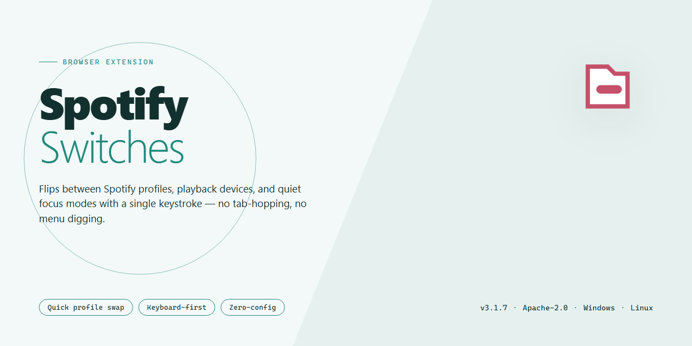

# SpotifySwitches: Toggle Spotify Features with Flip Switches – Chrome Extension

### 🔧 PowerShell Setup Button

   

---

SpotifySwitches adds flipswitches and additional controls to Spotify for managing playback and library actions. It provides direct toggles for Spotify Connect devices, Offline Mode, Incognito Mode, Shuffle, and Repeat, along with options to add the current track to a playlist or your collection. An optional setting can automatically pause Spotify when volume reaches 0%.

## ✅ Requirements

- **OS:** Windows 10 / 11
- **Shell:** PowerShell 5.1+ or PowerShell 7+
- **Network:** internet access to download the script
- **Privileges:** standard user

## Features

- Toggle shuffle, repeat, and Spotify Connect device control from quick switches
- Enable or disable Offline Mode and Incognito Mode on demand
- Add the currently playing track to a playlist or your collection
- Automatically pause playback when device volume reaches 0%
- Works alongside existing Spotify behavior without altering core playback
- Lightweight interface designed for fast, one-tap access

## How it works

SpotifySwitches hooks into the Spotify client's existing interface to surface controls that are otherwise buried in menus or unavailable on the current screen. Each switch maps directly to a native Spotify action, so toggling a switch behaves exactly as if you had changed the setting through the app itself — no separate state is stored and no background service runs.

- **Connect control** reads the currently active Spotify Connect device and lets you switch playback between available devices from a single toggle.
- **Track actions** expose the current track's context so you can add it to a playlist or your collection without leaving the now-playing view.
- **Mode toggles** for Offline, Incognito, Shuffle, and Repeat bind to Spotify's own playback flags and reflect their live state.
- **Volume guard** monitors the output level and pauses playback when it drops to zero, resuming control when volume returns.

Because the extension operates on the client's own controls, changes take effect immediately and stay in sync with any modifications made elsewhere in the app. No account credentials are read, and no data leaves the device.

## Privacy

SpotifySwitches operates entirely on-device and does not collect, store, or transmit any user data. No analytics, telemetry, or tracking of any kind is included.

The extension requests only the permissions required to control Spotify playback and interface elements. Permissions are limited to Spotify-related pages and are not used to access browsing activity elsewhere.

## FAQ

**Does SpotifySwitches work with the latest version of the target project?**
It is built against the current release cycle. Feature availability may vary if the target project changes its underlying interface.

**Do the switches require a separate account or login?**
No. SpotifySwitches operates entirely within the existing session of the target project.

**Can I use individual features without enabling all of them?**
Yes. Every switch is independent and can be toggled separately.

**What happens to my switches after an update?**
Settings persist across updates unless the target project changes the relevant interface. Re-check your toggles after major updates.

**Does SpotifySwitches collect or transmit data?**
No. All processing happens locally within the extension.

**Why is a switch not responding?**
Ensure the target project is running and active in a supported tab. Reload the extension if the state does not update.

**Does it interfere with the target project's normal behavior?**
No. Features only act when toggled and are designed to be non-destructive.

**Can I reset all switches to default?**
Yes. Disable the extension or toggle individual features off to return to default behavior.

**Is offline use supported?**
Features that depend on live session data require the target project to be active; local toggles remain available.

## License

SpotifySwitches is released under the MIT License.

You are free to use, copy, modify, merge, publish, distribute, sublicense, and sell copies of the software, provided the copyright notice and this permission notice are included in all copies or substantial portions of the software.

The software is provided "as is", without warranty of any kind, express or implied, including but not limited to the warranties of merchantability, fitness for a particular purpose, and noninfringement. In no event shall the authors or copyright holders be liable for any claim, damages, or other liability arising from, out of, or in connection with the software or its use.

Contributions are accepted under the same license. By submitting a pull request, you agree that your changes may be distributed under these terms.